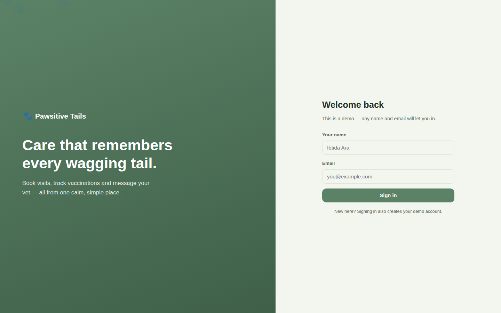
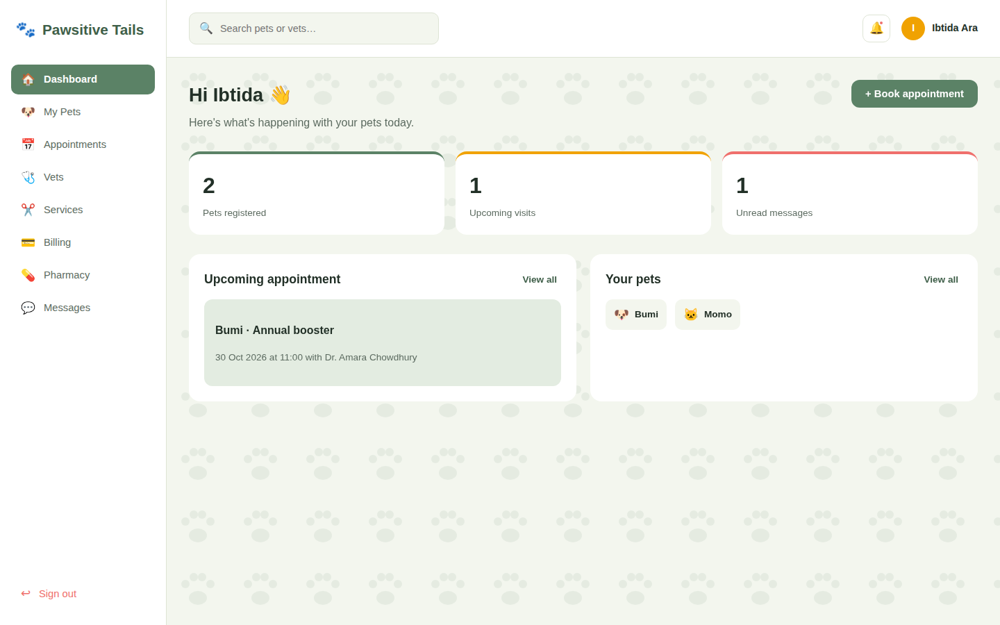
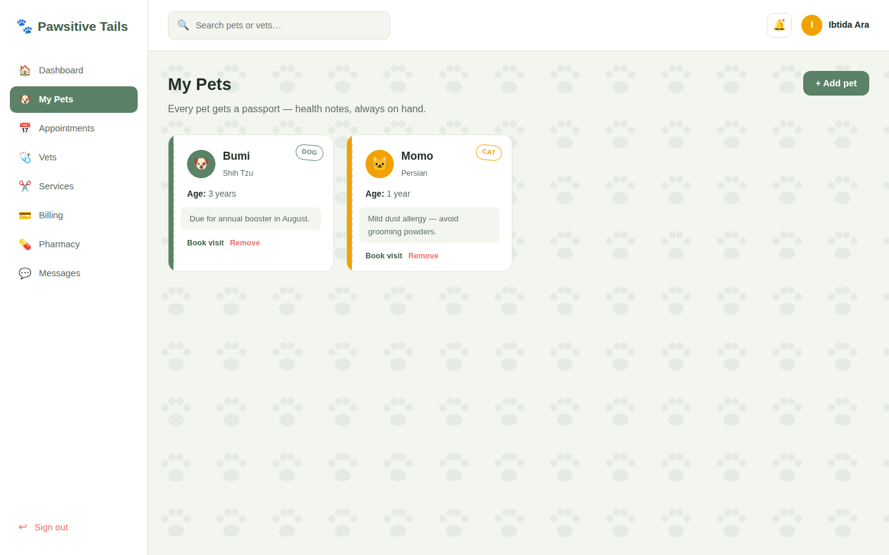
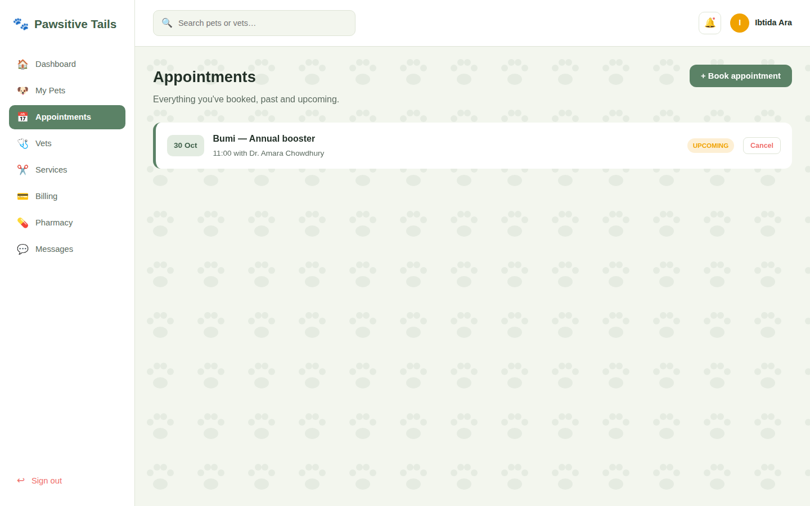
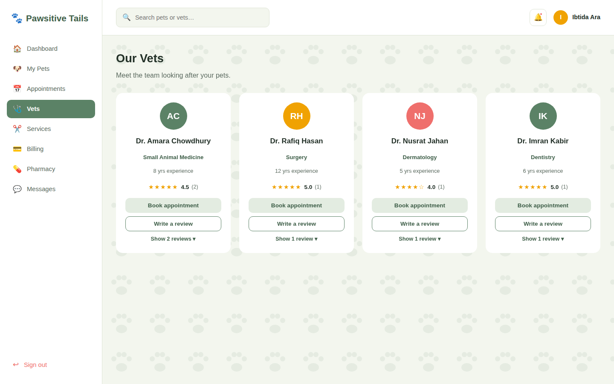
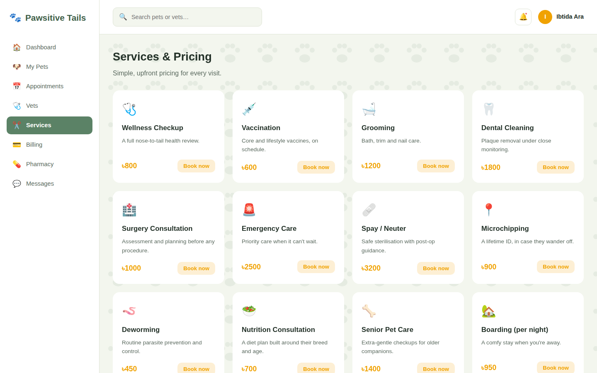
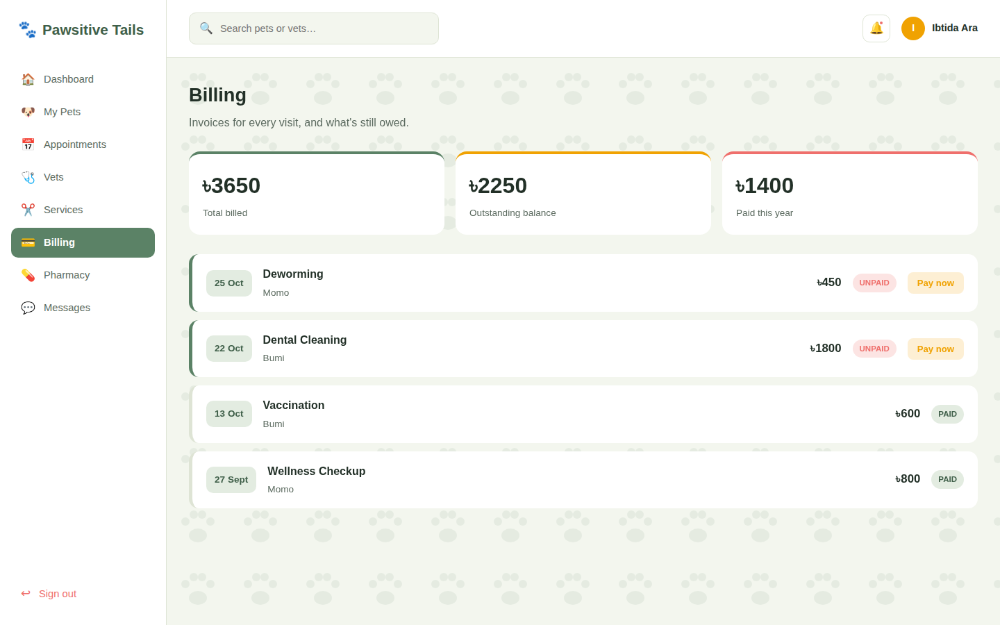
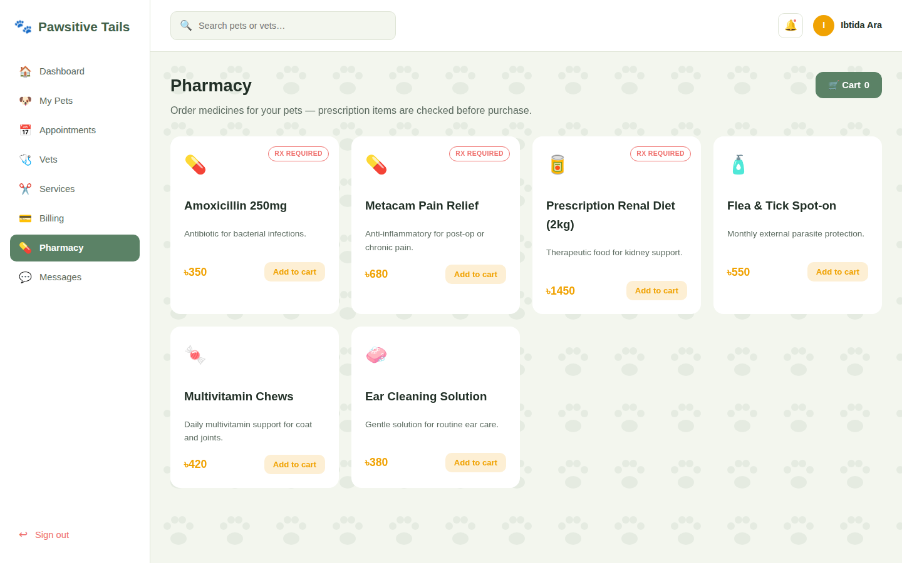
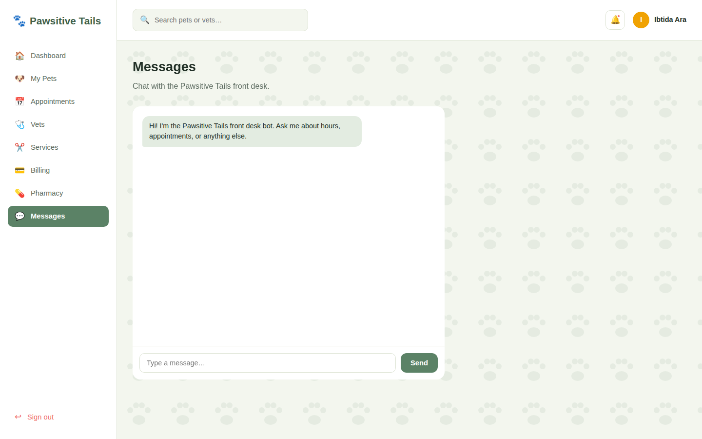

<div align="center">

# 🐾 Pawsitive Tails Veterinary Care

### Care that remembers.

**A friendly, interactive pet-care web app: manage pets, book vets, pay invoices, order from the pharmacy, and chat with the clinic, all in one place.**

<a href="https://ibtidaara5.github.io/PetCare-Pawsitive-Tails/"></a>
<a href="#-quick-start"></a>


</div>

---

## 📖 About

**Pawsitive Tails** is a single-page frontend demo of a veterinary care platform. Pet owners can sign in, keep profiles for their pets, book appointments with specialist vets, pay invoices, order medicine from an online pharmacy, and message the front desk.

It is built with plain **HTML, CSS and JavaScript**

---

## ✨ Features

<details open>
<summary><b>🏠 Dashboard</b></summary>

<br>

- Personal greeting and a card for your **next upcoming appointment**
- Quick overview of your pets
- Notification bell with updates

</details>

<details>
<summary><b>🐶 My Pets</b></summary>

<br>

- Add a pet with name, species (Dog, Cat, Rabbit, Bird, Other), breed, age and health notes
- Pet cards with an idle tail-wag animation
- Sample pets included: **Bumi** (Shih Tzu) and **Momo** (Persian cat)

</details>

<details>
<summary><b>📅 Appointments</b></summary>

<br>

- Book an appointment by choosing a pet, vet, date, time and reason for the visit
- Appointments are listed by date, and you can **cancel** a booking

</details>

<details>
<summary><b>🩺 Our Vets</b></summary>

<br>

- Four specialist vets with specialty and years of experience
- **Star-rating reviews** with a live star picker and average rating per vet

| Vet | Specialty |
|---|---|
| Dr. Amara Chowdhury | Small Animal Medicine |
| Dr. Rafiq Hasan | Surgery |
| Dr. Nusrat Jahan | Dermatology |
| Dr. Imran Kabir | Dentistry |

</details>

<details>
<summary><b>✂️ Services & Pricing</b></summary>

<br>

12 services with prices in BDT (৳), starting from **৳450**. Examples:

| Service | Price |
|---|---|
| 🩺 Wellness Checkup | ৳800 |
| 💉 Vaccination | ৳600 |
| 🛁 Grooming | ৳1,200 |
| 🦷 Dental Cleaning | ৳1,800 |
| 🚨 Emergency Care | ৳2,500 |
| 🩹 Spay / Neuter | ৳3,200 |
| 📍 Microchipping | ৳900 |

Also includes Surgery Consultation, Deworming, Nutrition Consultation, Senior Pet Care, and Boarding (per night).

</details>

<details>
<summary><b>💳 Billing</b></summary>

<br>

- Invoice list with **paid / unpaid** status
- Payment modal with a card form that auto-formats as you type (card number, expiry `MM/YY`, 3-digit CVV)
- "Processing…" state, then a success toast and paw confetti 🎉
- 🔒 Simulated only. No real payment, no stored card data

</details>

<details>
<summary><b>💊 Pharmacy</b></summary>

<br>

- Browse pet medicine and supplies with a **cart badge** and cart modal
- **Prescription-required items** (Amoxicillin 250mg, Metacam Pain Relief, Prescription Renal Diet) trigger a simulated prescription check before they are added
- Over-the-counter items include flea and tick treatment, multivitamin chews, and ear cleaning solution

</details>

<details>
<summary><b>💬 Messages</b></summary>

<br>

- Chat with the clinic front desk
- Auto-replies that understand simple questions about **opening hours**, **booking**, **prices**, **emergencies**, and thanks

</details>

<details>
<summary><b>🎨 Delight & Accessibility</b></summary>

<br>

- Paw-print confetti, toast notifications, and wiggling and floating paw animations
- Smooth view switching from a sidebar navigation
- Responsive layout
- `prefers-reduced-motion` support for people who prefer less animation

</details>

---

## 🚀 Quick Start

No installation needed.

```bash
git clone https://github.com/IbtidaAra5/PetCare-Pawsitive-Tails.git
cd PetCare-Pawsitive-Tails
```

Then open `index.html` in your browser. That's it.

### 🔑 Demo login

Enter **any name and any email** on the login screen. Signing in creates your demo account.

> 💡 Data is held in memory, so everything **resets when you reload the page**.

---

## 🧰 Tech Stack

| Layer | Technology |
|---|---|
| Structure | HTML5 |
| Styling | CSS3 (custom properties, animations, media queries) |
| Logic | Vanilla JavaScript (no frameworks) |
| Fonts | Fredoka (headings) and Inter (body) via Google Fonts |
| Data | In-memory demo state |

---

## 📁 Project Structure

```
PetCare-Pawsitive-Tails/
├── index.html    # Layout: login screen, sidebar, 8 views, modals
├── style.css     # Design system, layout, animations
├── script.js     # State, rendering, modals, chat, confetti
├── docs/
│   └── screenshots/   # README images
└── README.md
```

---

## 🎨 Design System

| Token | Color | Used for |
|---|---|---|
| Paper | `#F3F6EE` | Page background |
| Sage | `#5B8266` | Primary actions, brand |
| Sage Dark | `#3F5F49` | Hover and emphasis |
| Marigold | `#F0A202` | Highlights and ratings |
| Coral | `#EF6F6C` | Alerts and emergencies |
| Sand | `#E8E1CF` | Soft surfaces |
| Ink | `#223027` | Text |

---

## 🗺️ Roadmap

- [x] Login, dashboard and sidebar navigation
- [x] Pets, appointments, vets and services
- [x] Billing with simulated card payment
- [x] Pharmacy with cart and prescription check
- [x] Messages with auto-replies
- [ ] Save data with `localStorage` or a backend
- [ ] Real authentication
- [ ] Additional payment methods
- [ ] Admin and vet dashboards

---

## 📸 Screenshots

<table>
<tr>
<td align="center"><b>Login</b><br></td>
<td align="center"><b>Dashboard</b><br></td>
</tr>
<tr>
<td align="center"><b>My Pets</b><br></td>
<td align="center"><b>Appointments</b><br></td>
</tr>
<tr>
<td align="center"><b>Vets & Reviews</b><br></td>
<td align="center"><b>Services & Pricing</b><br></td>
</tr>
<tr>
<td align="center"><b>Billing</b><br></td>
<td align="center"><b>Pharmacy</b><br></td>
</tr>
<tr>
<td align="center"><b>Messages</b><br></td>
<td></td>
</tr>
</table>

---

## 🤝 Contributing

Suggestions and improvements are welcome.

1. Fork the repository
2. Create a branch: `git checkout -b feature/your-feature`
3. Commit your changes: `git commit -m "Add your feature"`
4. Push the branch and open a Pull Request

---
## Future work
1. real payment  proccedure
2. make sure card data is stored
3. the prescription check in realtime

## 👩‍💻 Author

**Ibtida Ara**: CSE student at United International University

[](https://github.com/IbtidaAra5)
[](https://www.linkedin.com/in/ibtida-ara-a505983b4)
[](https://ibtidaara5.github.io/)

---

<div align="center">

Made with 💚 for pets and the people who love them. 🐾

</div>
